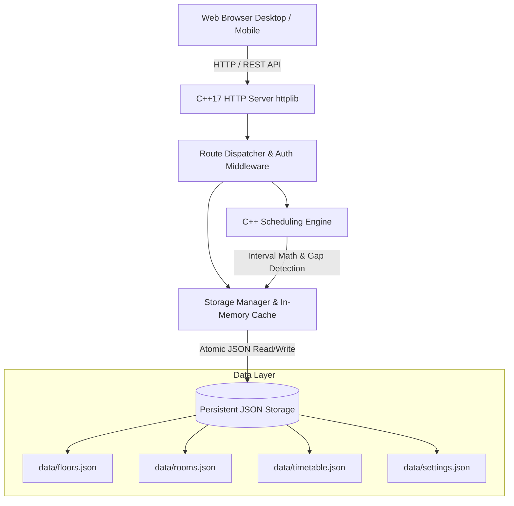

# Roomwise — Empty Classroom Finder & Campus Scheduling Engine

[](https://isocpp.org/)
[]()
[]()
[]()

> A functional, high-performance college campus utility designed for 9-floor academic buildings (over 140 classrooms). Roomwise eliminates the physical hassle of finding unoccupied classrooms for study sessions, club meetings, and faculty makeup lectures through real-time schedule analysis in modern C++.

---

## 🚀 Running Locally

1. Copy `.env.example` to `.env` and configure `ADMIN_PASSWORD`.
2. Build and launch:
   - **Public Student Portal:** [http://localhost:3000/](http://localhost:3000/)
   - **Admin Management Portal:** [http://localhost:3000/admin](http://localhost:3000/admin)
   - **Admin Authentication:** Configured via the `ADMIN_PASSWORD` environment variable (never hardcoded in source files).

---

## 🌟 Key Features

### 1. Public Student & Faculty Portal (`/`)
- **Interactive Building Directory:** Visual architectural representation of all 9 levels (Floor 9 down to Floor 1). Clicking any floor dynamically inspects its classrooms.
- **Dynamic Campus Metrics:** Real-time summary cards displaying Total Classrooms, Currently Available, Currently Occupied, and Total Floors (computed dynamically from data, not hardcoded).
- **Instant Empty Classroom Finder:**
  - Query availability across any floor for specific study hours, today, tomorrow, or future calendar dates.
  - Quick time presets: *Current Slot*, *Next 1 Hour*, *Morning (10:00 - 11:00)*, *Afternoon (14:00 - 15:00)*, and *Full Day*.
  - Displays preceding and following classes for matching rooms to prevent surprises.
  - Option to view complete 08:00 to 18:00 operating slot breakdowns for every room.
- **Detailed Day Schedule Modal:** Color-coded timeline bar (08:00 to 18:00) with green available gaps and red class lecture blocks.
- **Three-State Fail-Safe Display:**
  - 🟢 **Available:** Confirmed free between verified scheduled classes.
  - 🔴 **Occupied:** Confirmed active lecture/lab with course title and section.
  - ⚪ **Unavailable / No Timetable Data:** Rooms without verified schedules or outside operating hours are marked grey, ensuring students are never sent to unverified spaces.

### 2. Password-Protected Admin Portal (`/admin`)
- **Direct Backend Authentication:** Protected with session tokens generated from `POST /api/admin/login`. Unauthorized requests return HTTP 401.
- **Admin Dashboard:** Real-time campus counters, today's upcoming lectures list, and quick administrative actions.
- **Floor Management:** Add new floors, rename academic wings, view room distributions, and safely delete floors (preventing deletion if rooms are assigned).
- **Classroom Inventory:** Add, edit, and delete classrooms with configurable capacities and room types (*Lecture Hall*, *Computing Laboratory*, *Seminar Room*). Prevents duplicate room numbers.
- **Timetable CSV Import & Validation:**
  - Supports standard spreadsheet CSV columns: `room_number,section,subject,day,start_time,end_time`.
  - Row-by-row live validation preview: detects unknown room numbers, invalid time formats, inverted start/end times, and schedule collisions.
  - Choice between **Append** (skips conflicts) and **Replace** (with explicit confirmation).
  - Downloadable sample CSV template built right in.
- **Manual Timetable CRUD:** Search and filter schedules by room and day; add, edit, and delete individual lecture slots with conflict detection.
- **System Settings:** Configure college name, academic block title, operating hours (e.g., 08:00 – 18:00), and change administrator password.

---

## 🏗️ System Architecture



---

## 📂 Project Directory Structure

```text
Roomwise/
├── backend/
│   ├── main.cpp              # Application entry point, server setup & port binding
│   ├── models.h              # Data structures: TimeUtil, Floor, Classroom, ScheduleEntry, Settings
│   ├── scheduler.h           # Scheduling engine declaration & CSV validation structures
│   ├── scheduler.cpp         # Interval overlap algorithm, daily gap calculations & CSV parser
│   ├── storage.h             # Thread-safe persistent JSON storage & session management
│   ├── storage.cpp           # File I/O, realistic sample campus seed data (144 rooms, 9 floors)
│   ├── routes.h              # REST API endpoint registration & auth middleware declaration
│   └── routes.cpp            # Static file serving & REST endpoints (public + admin)
├── frontend/
│   ├── index.html            # Public student portal (building directory & empty room finder)
│   ├── admin.html            # Password-gated admin management dashboard
│   ├── styles.css            # Responsive design system (royal blue, pink accent, status colors)
│   ├── app.js                # Public client logic: real-time clock, dynamic search, modals
│   └── admin.js              # Admin client logic: auth token, CSV preview, CRUD operations
├── data/                     # Persistent JSON database (auto-created on startup)
│   ├── floors.json           # Configured levels (Floors 1-9)
│   ├── rooms.json            # Configured classrooms (101-116, 201-216, ..., 901-916)
│   ├── timetable.json        # Active recurring class schedules
│   └── settings.json         # Institutional settings & operating hours
├── samples/
│   └── sample_timetable.csv  # Downloadable sample CSV template for administrators
├── tests/
│   └── test_scheduler.cpp    # Automated unit tests verifying overlap rules & edge cases
├── include/
│   ├── httplib.h             # Single-header C++ HTTP server library
│   └── json.hpp              # Single-header nlohmann/json library
├── CMakeLists.txt            # CMake build configuration
├── build.bat                 # 1-click Windows compilation script (supports MSVC & MinGW)
├── run.bat                   # 1-click Windows startup script
├── viva_preparation.md       # Detailed viva defense notes & algorithm explanations
├── .gitignore                # Git ignore rules
└── README.md                 # Complete project documentation
```

---

## 🛠️ Build and Run Instructions

### Prerequisites
- Windows 10/11 (or Linux / macOS)
- A C++17 compatible compiler:
  - **Option A (Installed on this system):** Microsoft Visual Studio 2019/2022 C++ Build Tools (`cl.exe`)
  - **Option B:** MinGW-w64 (`g++`)
  - **Option C:** CMake 3.15+

### Method 1: Using 1-Click Batch Scripts (Windows)

To compile the application:
```cmd
build.bat
```
*`build.bat` automatically initializes the MSVC environment or MinGW and produces `roomwise.exe`.*

To run the application:
```cmd
run.bat
```
Or run directly:
```cmd
.\roomwise.exe --port 3000
```

### Method 2: Using CMake
```bash
mkdir build
cd build
cmake ..
cmake --build . --config Release
./roomwise --port 3000
```

### Running Core Unit Tests
```cmd
cl /std:c++17 /EHsc /Iinclude /Ibackend tests/test_scheduler.cpp backend/storage.cpp backend/scheduler.cpp ws2_32.lib crypt32.lib /Fe:test_runner.exe
.\test_runner.exe
```

---

## 📡 REST API Reference

### Public Endpoints
| Method | Endpoint | Description |
| :--- | :--- | :--- |
| `GET` | `/` | Serves the public homepage (`index.html`) |
| `GET` | `/api/settings` | Returns public college name, building name, operating hours |
| `GET` | `/api/summary` | Dynamic summary counts (total, free, occupied, floors) |
| `GET` | `/api/floors` | List of all floors with room counts |
| `GET` | `/api/floors/:num/rooms` | Classrooms on floor with statuses for given `date` and `time` |
| `GET` | `/api/rooms` | All classrooms with optional `?floor=` filter |
| `GET` | `/api/rooms/:room/schedule` | Day schedule and free/occupied slots breakdown for room |
| `GET` | `/api/rooms/:room/status` | Current status of a room at requested or current time |
| `GET` | `/api/availability` | Free rooms across interval (`?date=&start_time=&end_time=&floor=`) |
| `GET` | `/api/daily-availability` | Comprehensive day-long slot breakdown for all rooms |

### Admin Endpoints (Require `Authorization: Bearer <token>`)
| Method | Endpoint | Description |
| :--- | :--- | :--- |
| `GET` | `/admin` | Serves the admin portal (`admin.html`) |
| `POST` | `/api/admin/login` | Authenticate with `{ "password": "..." }` |
| `POST` | `/api/admin/logout` | Invalidate current session token |
| `GET` | `/api/admin/dashboard` | Administrative overview metrics & upcoming lectures |
| `POST` | `/api/admin/floors` | Add a new floor level |
| `PUT` | `/api/admin/floors/:num` | Edit floor name or description |
| `DELETE` | `/api/admin/floors/:num` | Delete floor (verified that no rooms are assigned) |
| `POST` | `/api/admin/rooms` | Add a new classroom |
| `PUT` | `/api/admin/rooms/:room` | Edit classroom details |
| `DELETE` | `/api/admin/rooms/:room` | Remove classroom and delete its scheduled classes |
| `POST` | `/api/admin/timetable/validate`| Parse and validate CSV rows without committing |
| `POST` | `/api/admin/timetable/import`| Import validated CSV rows (Append or Replace mode) |
| `GET` | `/api/admin/timetable` | List timetable records with room/day filters |
| `POST` | `/api/admin/timetable` | Add manual lecture schedule entry |
| `PUT` | `/api/admin/timetable/:id` | Edit lecture schedule entry |
| `DELETE` | `/api/admin/timetable/:id` | Delete lecture schedule entry |
| `GET` | `/api/admin/settings` | Full settings view |
| `PUT` | `/api/admin/settings` | Update operating hours, building title, or admin password |

---

## 🧮 Scheduling Algorithms & Availability Logic

### 1. Integer Time Representation
All times are stored as minutes past midnight:
$$\text{Minutes} = (\text{Hours} \times 60) + \text{Minutes}$$
*`08:00` $\to 480$, `09:30` $\to 570$, `18:00` $\to 1080$.*

### 2. Overlap Rule
A scheduled class $[S_c, E_c]$ overlaps a requested query $[S_q, E_q]$ if and only if:
$$(S_c < E_q) \land (E_c > S_q)$$
Adjacent classes (e.g., Class A from 10:00 to 11:00 and Class B from 11:00 to 12:00) **do not overlap** because $660 > 660$ is `false`.

### 3. Fail-Safe Coverage Rule
A room without timetable data configured in the system is explicitly marked **UNAVAILABLE** (Grey), preventing false reports of empty classrooms.

---

## 🎓 Viva Preparation Quick Reference

For complete interview preparation notes, see [viva_preparation.md](file:///c:/Users/Praveen%20Yadav/Downloads/RoomWise/viva_preparation.md):
- Core interval intersection algorithm derivation.
- Why integer arithmetic is preferred over floating-point or string comparisons.
- Thread safety with `std::mutex` during JSON file persistence.
- Time and space complexity: $O(R \times C)$ per query ($\approx 864$ operations for 144 rooms, executing in under 1 millisecond).
- Common questions and student sample answers.
